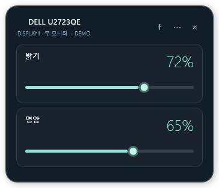

# LumaDock

[**Windows 설치 파일 다운로드 · 0.0.1 Beta**](https://github.com/SCOTT0318/LumaDock/releases/download/v0.0.1/LumaDock-0.0.1.exe)

[릴리스 설명](https://github.com/SCOTT0318/LumaDock/releases/tag/v0.0.1) · [SHA-256 체크섬](https://github.com/SCOTT0318/LumaDock/releases/download/v0.0.1/SHA256SUMS.txt)

Windows 모니터 밝기·명암 제어와 바탕화면 위젯.

현재 버전: **0.0.1 Beta**

## 설치

[0.0.1 베타 릴리스](https://github.com/SCOTT0318/LumaDock/releases/tag/v0.0.1)에서 `LumaDock-0.0.1.exe`를 내려받아 실행합니다.

- 기본 위치: `C:\LumaDock`
- 다른 부모 폴더 선택 시 그 아래 `LumaDock`을 만들어 설치합니다. 예: `D:\Apps` → `D:\Apps\LumaDock`
- 바탕화면·시작 메뉴 바로가기를 각각 선택할 수 있습니다.
- 완료 화면에서 앱 실행 여부를 선택합니다.
- Windows 앱 설정에서 제거할 수 있습니다. 위젯 설정과 설치 폴더의 무관한 파일은 보존합니다.

설치 프로그램은 관리자 권한을 요청합니다. 설치 후 앱은 일반 사용자 권한으로 실행됩니다. Windows 10/11, .NET Framework 4.8 이상이 필요합니다.

## 사용

왼쪽에서 모니터를 선택하고 슬라이더를 조절합니다. 밝기·명암을 기본으로, 모니터가 지원하는 볼륨·입력·색상 프리셋·RGB·선명도 항목이 추가됩니다. 입력·프리셋은 **적용**을 눌러 변경합니다.

**위젯**에서 모니터와 밝기·명암·볼륨 표시 항목을 선택합니다. 위젯 제목 부분을 드래그해 배치하며, 테마·항상 위에 표시·위치 잠금·앱 실행 시 복원을 설정할 수 있습니다. 위젯은 독립된 바탕화면 패널입니다. 모니터를 다시 연결하면 해당 위젯도 복원됩니다.

오른쪽 아래 알림 영역의 모니터 아이콘에서 앱 열기, 위젯 설정·표시, 다시 검색, 종료를 사용할 수 있습니다. 본창의 X는 트레이로 숨기며, 종료는 트레이 메뉴에서 합니다. Windows 설정에 따라 아이콘이 숨김 영역에 배치될 수 있습니다.

배치 설정과 오류 기록은 `%LocalAppData%\LumaDock`에 저장합니다. 밝기 등 하드웨어 값은 저장하거나 시작 시 덮어쓰지 않습니다. 여러 창의 조절 값은 동기화됩니다. 슬라이더는 마지막 조작 약 320ms 후 적용합니다.

외장 모니터의 DDC/CI를 켜야 합니다. 연결 장치·화면 모드에 따라 지원 기능이 달라집니다. 제조사 전용 OSD 항목은 등록된 표준 메뉴 외에 코드 정보만 표시합니다.




## 빌드

```powershell
.\build.ps1
.\build.ps1 -Test
.\build-installer.ps1 -Test
```

앱은 Windows의 .NET Framework C# 컴파일러를 사용합니다. Visual Studio에서는 `LumaDock.csproj`를 엽니다. 설치 파일 빌드는 Inno Setup 7을 사용하며 준비 방법은 `installer/README.md`에 있습니다. 결과물은 설치할 때 다운로드하지 않습니다.

```powershell
# 하드웨어에 접근하지 않는 데모
.\bin\LumaDock.exe --demo

# 현재 값과 지원 기능만 조회
Start-Process .\bin\LumaDock.exe -ArgumentList '--diagnose artifacts\monitors.json' -Wait

# 데모 화면과 위젯 미리보기 출력
Start-Process .\bin\LumaDock.exe -ArgumentList '--render-demo artifacts\preview-v2' -Wait
```

검사는 데모 제어·동기화, 설정 저장, 폴더·바로가기·제거를 확인합니다. 설치 검사는 별도 폴더와 테스트 바로가기를 사용하며 실제 바탕화면·시작 메뉴·제거 레지스트리를 변경하지 않습니다. 실제 모니터 값 쓰기는 자동 검증하지 않습니다.

API: [Microsoft 모니터 제어](https://learn.microsoft.com/en-us/windows/win32/monitor/monitor-configuration), [지원 기능 조회](https://learn.microsoft.com/en-us/windows/win32/monitor/using-the-low-level-monitor-configuration-functions), [WMI 밝기](https://learn.microsoft.com/en-us/windows/win32/wmicoreprov/wmimonitorbrightnessmethods), [VCP 코드](https://www.ddcutil.com/vcpinfo_output/).
