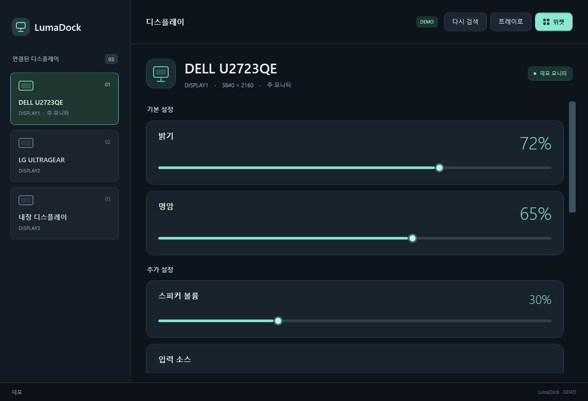
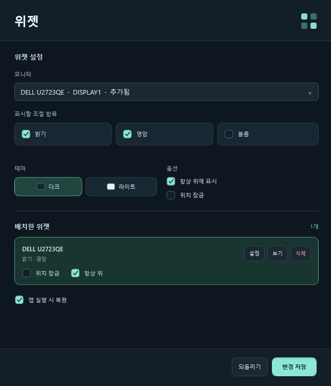

# LumaDock

[**Windows 설치 파일 다운로드 · 1.0.3**](https://github.com/SCOTT0318/LumaDock/releases/download/v1.0.3/LumaDock-1.0.3.exe)

[릴리스 설명](https://github.com/SCOTT0318/LumaDock/releases/tag/v1.0.3) · [SHA-256 체크섬](https://github.com/SCOTT0318/LumaDock/releases/download/v1.0.3/SHA256SUMS.txt)

Windows 모니터 밝기·명암 제어와 바탕화면 위젯.

현재 버전: **1.0.3**

## 설치

[1.0.3 릴리스](https://github.com/SCOTT0318/LumaDock/releases/tag/v1.0.3)에서 `LumaDock-1.0.3.exe`를 내려받아 실행합니다. 처음 업데이트할 때는 트레이 메뉴의 **종료**로 기존 앱을 닫으세요.

- 기본 위치: `C:\LumaDock`
- 다른 부모 폴더 선택 시 그 아래 `LumaDock`을 만들어 설치합니다. 예: `D:\Apps` → `D:\Apps\LumaDock`
- 바탕화면·시작 메뉴 바로가기를 각각 선택할 수 있습니다.
- 완료 화면에서 앱 실행 여부를 선택합니다.
- Windows 앱 설정에서 제거할 수 있습니다. 위젯 설정과 설치 폴더의 무관한 파일은 보존합니다.

설치 프로그램은 관리자 권한을 요청합니다. 설치 후 앱은 일반 사용자 권한으로 실행됩니다. Windows 10/11, .NET Framework 4.8 이상이 필요합니다.

## 사용

왼쪽에서 모니터를 선택하고 슬라이더를 조절합니다. 밝기·명암을 기본으로, 모니터가 지원하는 볼륨·입력·색상 프리셋·RGB·선명도 항목이 추가됩니다. 입력·프리셋은 **적용**을 눌러 변경합니다.

**설정**에서 모니터별 이름을 지정합니다. 이름을 비우면 모델명으로 돌아갑니다. 배치 지도와 왼쪽·오른쪽·위·아래 표시로 위치를 확인하고 **식별**을 누르면 해당 화면에 번호가 나타납니다.

트레이 아이콘을 **왼쪽 클릭**하면 밝기 팝업을 엽니다. 맨 위의 **전체 밝기**로 연결된 모니터를 같은 밝기로 함께 조절하거나, 아래에서 모니터별로 조절합니다. 현재 밝기가 서로 다르면 전체 값에 **서로 다름**이 표시됩니다. **오른쪽 클릭** 메뉴에서 본창·설정·업데이트 확인·종료를 선택합니다.

**설정 → 키보드 밝기 조절**을 켜고 대상을 **모두 함께 / 마우스가 있는 모니터 / 선택한 모니터만** 중 고릅니다. 기본 단축키는 **Ctrl+Alt+↑/↓**입니다. Windows 밝기 변경과 표준 HID 밝기 키도 연동할 수 있습니다. Fn 키는 키보드·펌웨어가 Windows에 입력을 노출하는 경우에 동작하며, 일부 기기는 내장 화면의 밝기도 자체적으로 변경합니다. 원하는 모니터만 정확하게 조절하려면 기본 단축키를 사용하세요.

**업데이트 확인**에서 새 버전을 확인하고 **다운로드 및 설치**로 업데이트합니다. 설정에서 시작 시 자동 확인을 끌 수 있습니다. 다운로드는 GitHub 공개 릴리스에서 가져오며 SHA-256 체크섬 검증 후 앱을 종료하고 같은 설치 위치에 설치 프로그램을 엽니다.

**설정 → 실행**에서 **Windows 시작 시 자동 실행**을 켜고 끕니다. 기본값은 켜짐이며 현재 사용자의 Windows 로그인에만 적용됩니다. 자동 실행은 본창 없이 트레이에서 시작합니다. **트레이에서 시작**을 켜면 직접 실행할 때도 본창을 표시하지 않습니다. 트레이 오른쪽 메뉴의 **LumaDock 열기**로 본창을 엽니다. 이미 실행 중일 때 바로가기를 다시 실행해도 본창을 열 수 있습니다. 기존 위젯은 지정한 복원 설정을 따릅니다.

**위젯**에서 모니터와 밝기·명암·볼륨 표시 항목을 선택합니다. 위젯 제목 부분을 드래그해 배치하며, 테마·항상 위에 표시·위치 잠금·앱 실행 시 복원을 설정할 수 있습니다. 위젯은 독립된 바탕화면 패널입니다. 모니터를 다시 연결하면 해당 위젯도 복원됩니다.

위젯은 **모니터당 1개**입니다. 이미 추가한 모니터를 선택하면 기존 위젯의 설정이 열립니다. 목록에서 **위치 잠금·항상 위**를 바로 바꾸거나, **설정**에서 테마와 조절 항목을 수정하고 **변경 저장**을 누르세요. 저장 전 변경은 **되돌리기**로 취소합니다. 연결이 끊긴 모니터도 위치 잠금·테마 등의 설정을 수정할 수 있습니다.

이전 버전에서 같은 모니터의 위젯을 여러 개 추가했다면 첫 위젯의 위치와 모양을 유지하고 표시 항목을 합쳐 1개로 정리합니다.

본창의 X는 트레이로 숨기며, 종료는 트레이 메뉴에서 합니다. Windows 설정에 따라 아이콘이 숨김 영역에 배치될 수 있습니다.

배치 설정과 오류 기록은 `%LocalAppData%\LumaDock`에 저장합니다. 밝기 등 하드웨어 값은 저장하거나 시작 시 덮어쓰지 않습니다. 여러 창의 조절 값은 동기화됩니다. 슬라이더는 마지막 조작 약 320ms 후 적용합니다.

키보드·Windows 연동 밝기는 짧은 연속 입력을 최신 값으로 합쳐 대상 모니터에 병렬로 요청합니다. Windows가 이미 변경한 화면에는 같은 변화를 다시 적용하지 않습니다. 외장 화면 밝기는 변경 후 한 번 확인하며, 통신에 실패한 모니터는 추가 제어를 중지합니다.

**설정 → HDMI 연결 안정성 → HDMI 안정 모드**는 기본으로 켜집니다. HDMI는 밝기·명암만 조회하고 명령 사이에 간격을 두며, 자동 화면 재검색에서는 알려진 제어 정보를 재사용합니다. HDMI의 추가 기능이 필요하면 이 옵션을 끄고 저장하세요. DP의 지원 기능은 계속 조회합니다.

HDMI 화면이 깨지거나 신호가 없어지면 **트레이 오른쪽 클릭 → HDMI 신호 복구 → 해당 모니터**를 실행합니다. 본창에서 HDMI 모니터를 선택해도 복구 버튼이 나타납니다. 현재 배치·해상도·주사율 구성을 검증한 뒤 같은 구성을 그래픽 드라이버에 강제로 적용합니다. 모든 화면이 잠깐 깜박일 수 있습니다. 통신 실패로 중지한 HDMI는 재검색만으로 제어를 재개하지 않으며, 복구 요청 뒤 새 제어 연결을 엽니다. 이 기능은 모니터 내부 고장이나 물리 케이블 문제의 복구를 보장하지 않습니다.

HDMI 제어·실패·복구 요청은 `%LocalAppData%\LumaDock\display.log`에 기록합니다. 화면 신호 문제는 Windows가 연결을 정상으로 보고해도 발생할 수 있어, 단순 밝기 통신 실패만으로 화면 초기화를 자동 실행하지 않습니다.

외장 모니터의 DDC/CI를 켜야 합니다. 연결 장치·화면 모드에 따라 지원 기능이 달라집니다. 제조사 전용 OSD 항목은 등록된 표준 메뉴 외에 코드 정보만 표시합니다.






## 빌드

```powershell
.\build.ps1
.\build.ps1 -Test
.\build-installer.ps1 -Test
```

앱은 Windows의 .NET Framework C# 컴파일러를 사용합니다. Visual Studio에서는 `LumaDock.csproj`를 엽니다. 설치 파일 빌드는 Inno Setup 7을 사용하며 준비 방법은 `installer/README.md`에 있습니다. 결과물은 설치할 때 다운로드하지 않습니다.

```powershell
# 하드웨어에 접근하지 않는 데모
.\bin\LumaDock.exe --demo

# 현재 값과 지원 기능만 조회
Start-Process .\bin\LumaDock.exe -ArgumentList '--diagnose artifacts\monitors.json' -Wait

# DDC 통신이나 화면 초기화 없이 Windows 화면 구성과 복구 가능 여부만 검증
Start-Process .\bin\LumaDock.exe -ArgumentList '--diagnose-display artifacts\display.json' -Wait

# 데모 화면과 위젯 미리보기 출력
Start-Process .\bin\LumaDock.exe -ArgumentList '--render-demo artifacts\preview-v2' -Wait
```

검사는 데모 제어·동기화, 설정 저장, 폴더·바로가기·제거를 확인합니다. 설치 검사는 별도 폴더와 테스트 바로가기를 사용하며 실제 바탕화면·시작 메뉴·제거 레지스트리를 변경하지 않습니다. 실제 모니터 값 쓰기는 자동 검증하지 않습니다.

API: [Microsoft 모니터 제어](https://learn.microsoft.com/en-us/windows/win32/monitor/monitor-configuration), [지원 기능 조회](https://learn.microsoft.com/en-us/windows/win32/monitor/using-the-low-level-monitor-configuration-functions), [WMI 밝기](https://learn.microsoft.com/en-us/windows/win32/wmicoreprov/wmimonitorbrightnessmethods), [VCP 코드](https://www.ddcutil.com/vcpinfo_output/).
