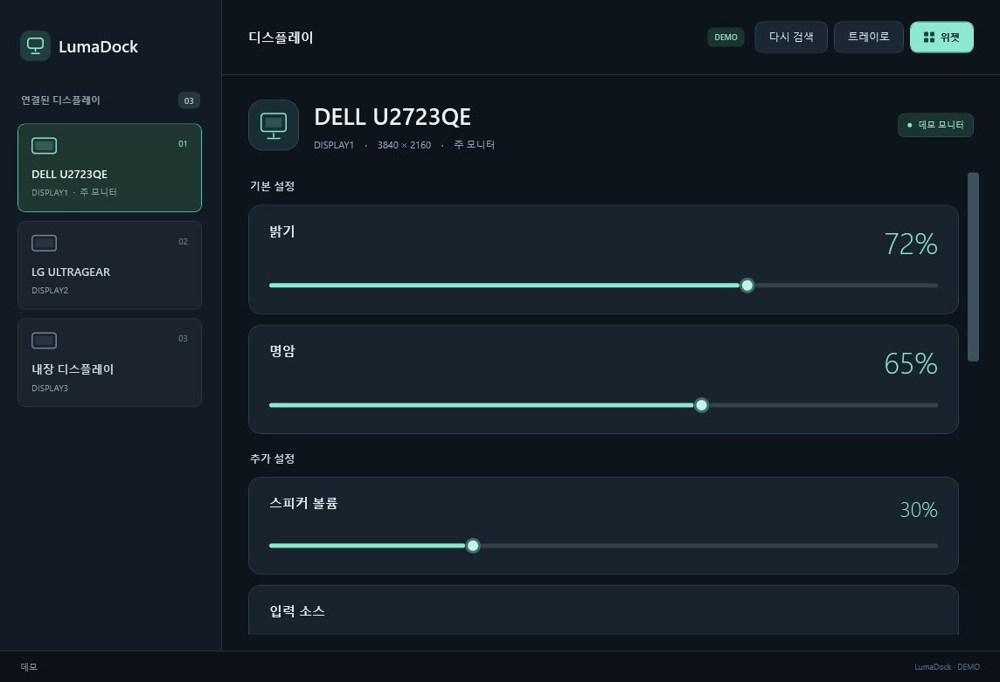
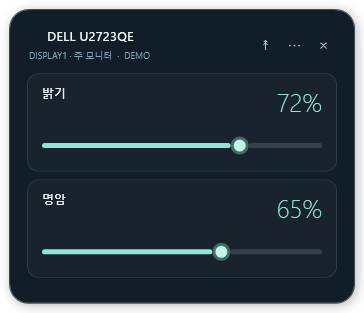

Windows 모니터 제어 앱 **LumaDock의 첫 공개 베타**입니다. 모니터별 밝기·명암을 조절하고 자주 쓰는 설정을 바탕화면 위젯에 배치할 수 있습니다.

## 다운로드 및 설치

**[LumaDock-Setup-0.0.1.exe 다운로드](https://github.com/SCOTT0318/LumaDock/releases/download/v0.0.1/LumaDock-Setup-0.0.1.exe)** · [SHA-256 체크섬](https://github.com/SCOTT0318/LumaDock/releases/download/v0.0.1/SHA256SUMS.txt)

1. 설치 EXE를 실행합니다. 설치에는 관리자 권한이 필요합니다.
2. 설치 위치를 선택합니다. 기본 경로는 `C:\LumaDock`입니다. 다른 부모 폴더를 선택하면 그 아래 `LumaDock` 폴더를 만듭니다. 예: `D:\Apps` → `D:\Apps\LumaDock`.
3. 바탕화면·시작 메뉴 바로가기를 각각 선택합니다.
4. 완료 화면에서 **LumaDock 실행** 여부를 선택합니다.

**지원 환경:** Windows 10/11, .NET Framework 4.8 이상.

## 주요 기능

- **모니터별 제어:** 밝기·명암을 기본으로, 지원 기능에 따라 입력 소스·색상 프리셋·RGB 게인·볼륨·선명도 메뉴를 구성합니다.
- **바탕화면 위젯:** 밝기·명암·볼륨 항목 선택, 드래그 배치, 다크·라이트 테마, 항상 위에 표시, 위치 잠금과 배치 복원을 지원합니다.
- **실시간 동기화:** 본창과 위젯의 값을 동기화하고 모니터 재연결 시 위젯을 복원합니다.
- **시스템 트레이:** 모니터 아이콘에서 앱 열기, 위젯 표시·설정, 다시 검색과 종료를 사용할 수 있습니다. 본창의 X는 트레이로 숨깁니다.
- **설치·제거:** 설치 폴더와 바로가기를 선택하고 Windows 앱 설정에서 제거할 수 있습니다.

## 화면

데모 모드의 앱 화면입니다.

## 베타 안내

- 외장 모니터의 OSD에서 **DDC/CI**를 켜야 합니다. 모니터·연결 장치·화면 모드에 따라 지원 항목이 달라집니다.
- 제조사 전용 OSD 기능은 등록된 표준 메뉴 외에 코드 정보만 표시합니다.
- 자동 검사는 실제 모니터 설정값을 바꾸지 않습니다. 실제 하드웨어 값 쓰기는 아직 자동 검증하지 않았습니다.

## 검증

**104개 검사 통과:** 제어 로직 21개, 설정 저장 26개, 데모 UI·위젯 34개, 격리 설치·제거 23개.

문제는 [Issues](https://github.com/SCOTT0318/LumaDock/issues)에 모니터 모델과 연결 방식, 재현 순서를 함께 남겨주세요.
