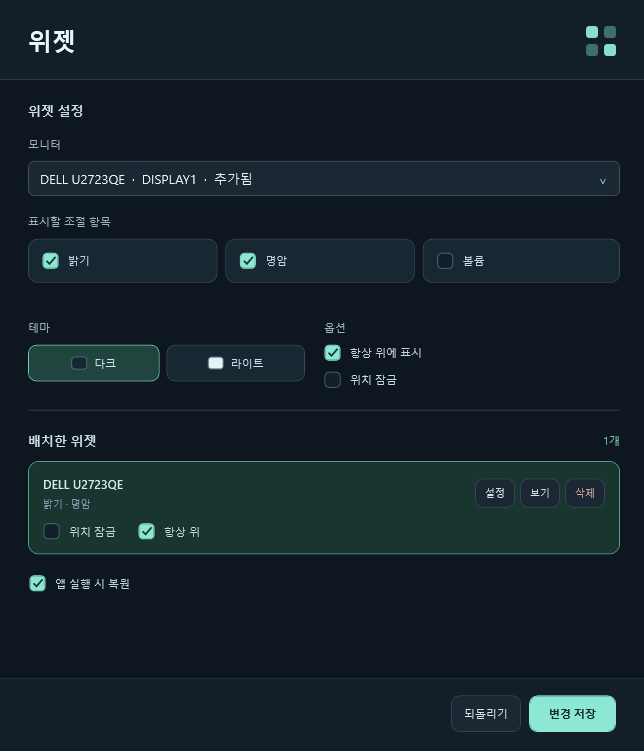

위젯 중복 추가를 막고, 추가한 위젯의 설정을 바로 수정할 수 있도록 개선한 **0.0.2 Beta**입니다.

## 변경 사항

- **모니터당 위젯 1개:** 이미 추가한 모니터를 선택하면 기존 위젯의 설정이 열립니다. 같은 모델의 다른 모니터는 각각 구분합니다.
- **목록에서 바로 변경:** 배치한 위젯의 **위치 잠금·항상 위**를 즉시 변경할 수 있습니다.
- **설정 수정:** **설정** 또는 위젯의 **⋯**에서 테마·표시 항목·고정 옵션을 바꾼 뒤 **변경 저장**을 누르세요. **되돌리기**도 지원합니다.
- **연결 대기 중에도 수정:** 모니터가 연결되지 않아도 테마·위치 잠금·항상 위 설정을 바꿀 수 있습니다. 기존 표시 항목은 유지합니다.
- **기존 중복 정리:** 같은 모니터의 위젯은 첫 위젯의 위치·모양·고정 설정을 유지하고, 표시 항목을 합쳐 1개로 복원합니다.

## 다운로드 및 설치

**[LumaDock-0.0.2.exe 다운로드](https://github.com/SCOTT0318/LumaDock/releases/download/v0.0.2/LumaDock-0.0.2.exe)** · [SHA-256 체크섬](https://github.com/SCOTT0318/LumaDock/releases/download/v0.0.2/SHA256SUMS.txt)

1. 기존 앱이 실행 중이면 트레이 메뉴에서 **종료**합니다. 본창의 X는 트레이로 숨기는 버튼입니다.
2. 설치 EXE를 실행합니다. 기본 경로는 `C:\LumaDock`이며 다른 부모 폴더를 선택하면 그 아래 `LumaDock`에 설치합니다.
3. 바탕화면·시작 메뉴 바로가기와 설치 완료 후 실행 여부를 선택합니다.

설치에는 관리자 권한이 필요합니다. 기존 위젯 설정은 유지됩니다.

**지원 환경:** Windows 10/11, .NET Framework 4.8 이상.

## 위젯 설정 화면

데모 모드의 화면입니다.

## 검증 및 베타 안내

**127개 검사 통과:** 제어 로직 21개, 설정 저장·중복 병합 35개, 데모 UI·위젯 48개, 격리 설치·제거 23개.

모니터별 지원 항목은 DDC/CI·연결 장치·화면 모드에 따라 달라집니다. 자동 검사는 실제 모니터 값을 변경하지 않습니다.

[전체 사용 방법](https://github.com/SCOTT0318/LumaDock#readme) · [문제 제보](https://github.com/SCOTT0318/LumaDock/issues)
