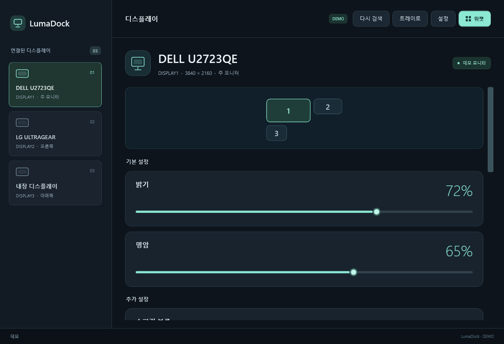
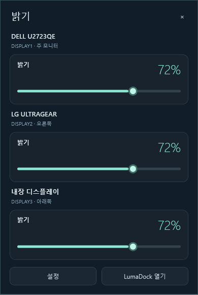
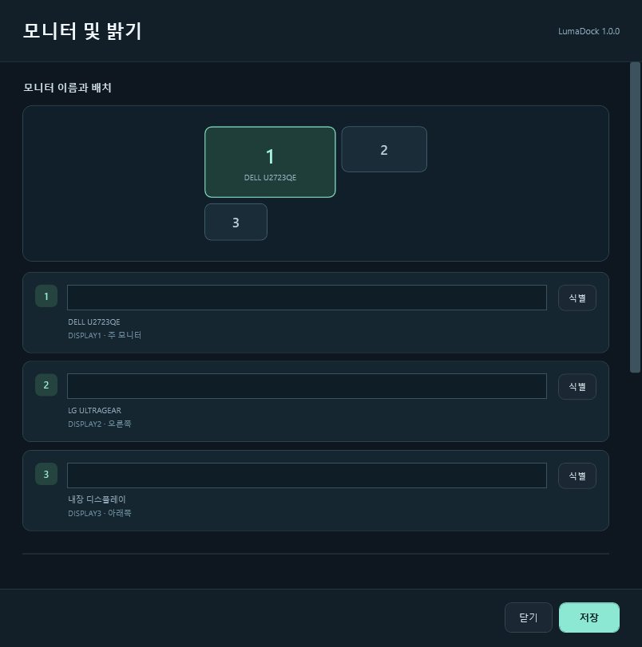

**LumaDock 1.0.0** 정식 릴리스입니다. 모니터 이름·배치 표시, 트레이 밝기 팝업, 키보드 조절 대상 설정과 앱 업데이트를 추가했습니다.

## 주요 변경 사항

- **모니터 이름 지정:** 모니터별 이름을 저장합니다. 이름을 비우면 원래 모델명을 표시합니다.
- **배치와 식별:** 실제 화면 배치 지도와 왼쪽·오른쪽·위·아래 위치를 표시합니다. 식별 버튼으로 해당 화면에 번호를 띄울 수 있습니다.
- **트레이 밝기 팝업:** 아이콘을 왼쪽 클릭하면 연결된 화면들의 이름·위치·밝기가 나타납니다. 오른쪽 클릭 메뉴에서 본창과 설정을 엽니다.
- **키보드 조절 대상:** 모두 함께, 마우스가 있는 모니터, 지정한 모니터만 중에서 선택합니다. 밝기 조절 단계와 기본 단축키 `Ctrl+Alt+↑/↓`를 설정합니다.
- **Windows 밝기 연동:** Windows 밝기 이벤트와 표준 HID 밝기 키 입력을 외장 화면에 연동합니다. 같은 입력이 중복 적용되거나 앱의 변경이 다시 연동되는 것을 억제합니다.
- **앱 업데이트:** 시작 시 확인 또는 수동 확인을 지원합니다. 설치 파일과 SHA-256 체크섬을 확인한 뒤 앱을 종료하고 기존 위치의 설치 프로그램을 실행합니다.
- **설정 유지:** 기존 위젯 배치, 중복 위젯 정리, 연결 대기 중 설정 수정 기능을 유지합니다. 연결 변경 중에도 저장하지 않은 모니터 설정을 보존합니다.

## 다운로드 및 설치

**[LumaDock-1.0.0.exe 다운로드](https://github.com/SCOTT0318/LumaDock/releases/download/v1.0.0/LumaDock-1.0.0.exe)** · [SHA-256 체크섬](https://github.com/SCOTT0318/LumaDock/releases/download/v1.0.0/SHA256SUMS.txt)

0.x 버전에서는 기존 앱을 트레이의 **종료**로 닫고 설치 EXE를 실행하세요. 1.0.0부터는 앱의 **업데이트 확인**에서 이후 버전을 설치할 수 있습니다.

기본 설치 위치는 `C:\LumaDock`입니다. 다른 부모 폴더를 선택하면 그 아래 `LumaDock`에 설치합니다. 바탕화면·시작 메뉴 바로가기와 설치 후 실행 여부를 선택할 수 있습니다. 설치에는 관리자 권한이 필요하며 기존 설정은 유지됩니다.

**지원 환경:** Windows 10/11, .NET Framework 4.8 이상.

## 키보드 설정

**설정 → 키보드 밝기 조절**을 켜고 조절 대상을 선택하세요. 마우스 위치와 무관하게 특정 화면만 조절하려면 **선택한 모니터만**을 선택합니다.

Fn 키는 키보드·펌웨어가 Windows에 입력을 노출하는 경우에 연동됩니다. 일부 노트북은 자체적으로 내장 화면 밝기도 변경합니다. 선택한 화면만 정확하게 조절하려면 기본 단축키를 사용하세요. 외장 모니터는 DDC/CI가 활성화되어 있어야 합니다.

## 화면

데모 모드의 화면입니다.

## 검증

**247개 검사 통과:** 제어 로직 21개, 위젯 설정 35개, 밝기 입력 24개, 업데이트 검증 32개, 이름·대상 설정 30개, 기존 UI·위젯 48개, 새 화면 통합 34개, 격리 설치·제거 23개.

자동 검사는 실제 밝기 값을 변경하지 않습니다. 실제 Fn 키 노출 여부와 모니터 쓰기 지원은 하드웨어에 따라 달라집니다.

[사용 방법](https://github.com/SCOTT0318/LumaDock#readme) · [문제 제보](https://github.com/SCOTT0318/LumaDock/issues)
